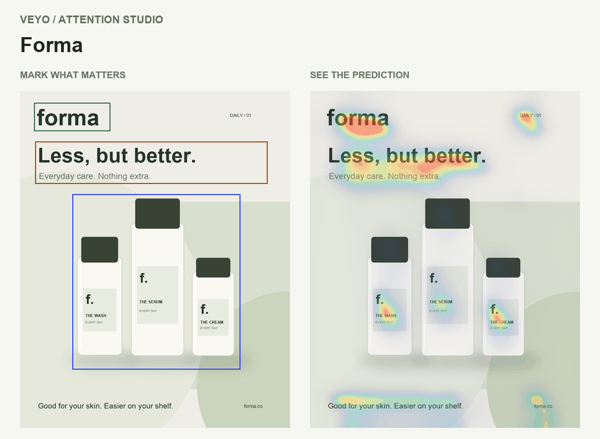
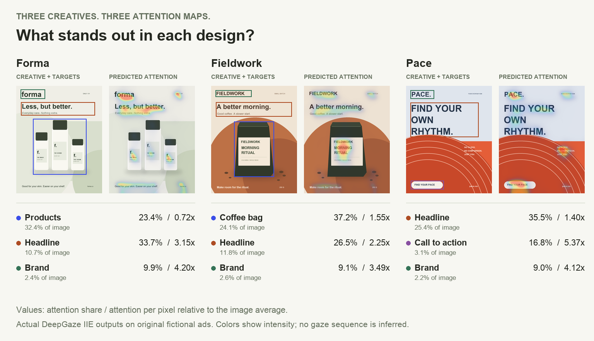
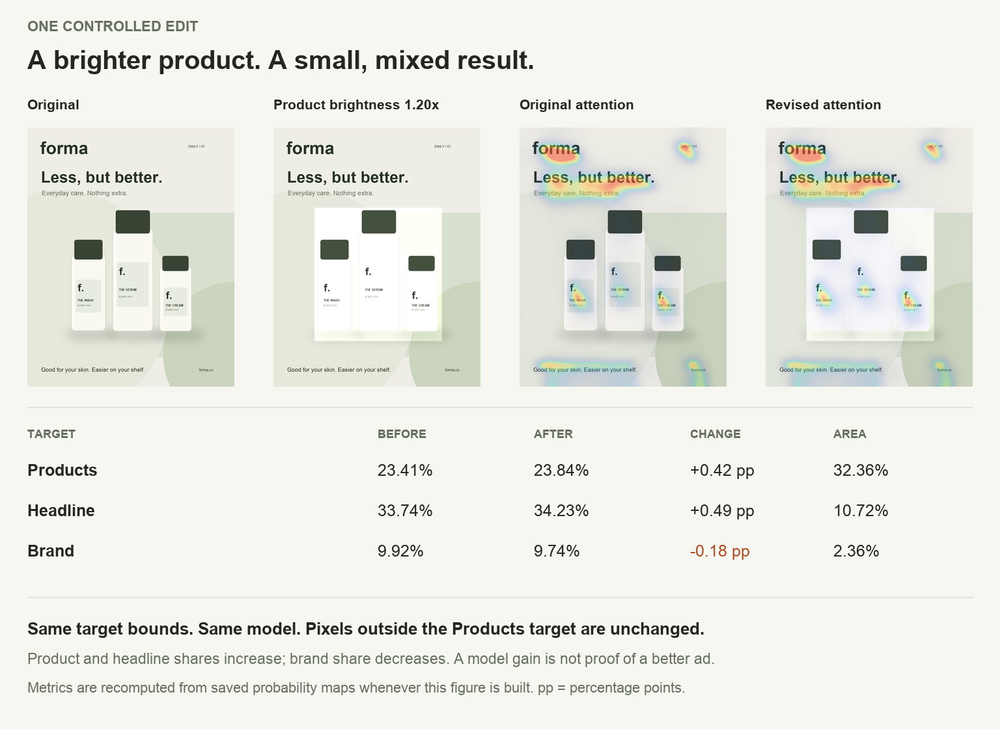
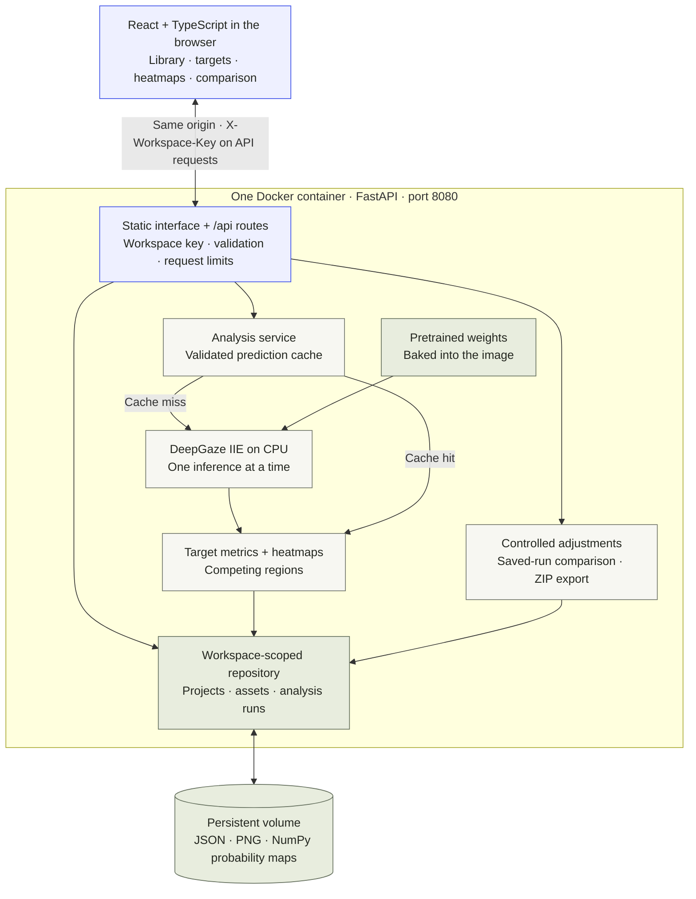

<h1 align="center">Veyo</h1>

<p align="center"><b>See what stands out in your ad before deciding what to change.</b><br>
Mark the product, headline, logo, or call to action. Veyo runs a visual attention model over the creative, shows where its predictions land, and measures what changes between versions.</p>

<p align="center">
  
</p>

<p align="center">
  <a href="#how-it-works">How it works</a> ·
  <a href="#what-the-model-sees">Examples</a> ·
  <a href="#system-design">System design</a> ·
  <a href="#run-it">Run it</a>
</p>

## How it works

1. **Mark the important elements.** Upload a PNG or JPEG and draw up to eight named targets. Each version keeps its own annotations.
2. **Run the model.** [DeepGaze IIE](https://github.com/matthias-k/DeepGaze) produces a probability map on the same pixel grid as the creative. Veyo overlays that map and finds competing regions outside your targets.
3. **Read attention alongside size.** A target gets an attention share and an area share. Their ratio tells you how much predicted attention it receives per pixel compared with the image average.
4. **Change something and compare.** Upload a revision or adjust brightness, contrast, saturation, or sharpness. Analyze it again and compare corresponding elements. Positive and negative changes both stay visible.

## What the model sees

<p align="center"></p>

These are original fictional ads included with Veyo. Their heatmaps come from actual CPU inference, with the same preprocessing and scoring code the app uses.

- **Forma: the headline draws more attention than the products.** The product region covers **32.4%** of the image but receives **23.4%** of predicted attention. The headline occupies **10.7%** and receives **33.7%**. The largest target is not necessarily the strongest.
- **Fieldwork: the coffee bag attracts attention beyond its area.** It occupies **24.1%** of the image and receives **37.2%** of attention, or **1.55×** the image average per pixel.
- **Pace: a small call to action can stand out.** The bottom button covers **3.1%** of the image and receives **16.8%** of attention, or **5.37×** the image average per pixel.

Heatmap colors show spatial intensity. They do not show the order a person looks at the ad. Exact measurements and model identity are saved in [`docs/media/measurements.json`](docs/media/measurements.json).

## One edit, with a tradeoff

<p align="center"></p>

This experiment raises brightness to **1.20× inside the Products rectangle**, including the background within that rectangle. Target bounds and image dimensions stay fixed; every pixel outside the rectangle stays unchanged. DeepGaze then analyzes the revised image from scratch.

| Target   | Original attention | Revised attention |       Change |
| -------- | -----------------: | ----------------: | -----------: |
| Products |             23.41% |            23.84% | **+0.42 pp** |
| Headline |             33.74% |            34.23% | **+0.49 pp** |
| Brand    |              9.92% |             9.74% | **−0.18 pp** |

The product gains a little attention, but the brand loses some. This is a measured tradeoff, not a recommendation to keep the edit. Veyo saves the original, revision, settings, and both analyses so you can decide whether the change serves the creative.

The figures are rebuilt from saved model probabilities by [`scripts/make_readme.py`](scripts/make_readme.py). The illustrated revision is also saved [as a PNG](docs/media/forma-brighter-products.png).

## What the numbers mean

- **Attention share** is predicted fixation probability inside a marked target. It is not a percentage of viewers or a click-through rate.
- **Relative attention** divides attention share by area share. **1×** is the image average per pixel; **2×** is twice that average. Read it together with the actual target bounds.
- **Comparison changes** are percentage points, not percent improvement. Overlapping targets count once in the combined total. Corresponding targets are matched by label and role.

There is no single “better ad” score. These results do not establish human attention, gaze order, brand recall, conversions, or sales. Veyo keeps losing revisions visible and reports inference failures without substituting a fabricated heatmap. It does not automatically approve or reject edits.

## System design

One container serves the built React interface, the API, and the CPU model. The browser makes all requests to the same origin.



| Component                                          | Responsibility                                                                                                                                                                   |
| -------------------------------------------------- | -------------------------------------------------------------------------------------------------------------------------------------------------------------------------------- |
| [Interface](frontend/src/)                         | Creative library, target drawing, aligned overlays, revision controls, and comparisons. Designed in [Figma](https://www.figma.com/design/gxDTce6luov9uIGO95ehO4?node-id=2-2).    |
| [Image intake](backend/veyo/ingest.py)             | Validate static PNG/JPEG uploads, apply EXIF orientation, composite transparency onto white, and limit the longest side to 1600 pixels. Targets and predictions share that grid. |
| [Inference engine](backend/veyo/engine.py)         | Load one real DeepGaze model lazily and reuse it. Concurrent inference receives a retryable busy response.                                                                       |
| [Analysis service](backend/veyo/analysis.py)       | Validate cached maps against image hash and model identity, compute metrics, render overlays, and retain target snapshots for each run.                                          |
| [Revision comparison](backend/veyo/comparisons.py) | Compare completed runs from the same project and model configuration, matching elements by label and role.                                                                       |
| [File repository](backend/veyo/repository.py)      | Scope projects, assets, and runs to a hash of the browser's workspace key. Write local files atomically and keep images separate from JSON metadata.                             |

**Why no database?** This version stores a small creative library as independent files and JSON records. A persistent volume preserves them when the container is replaced. Completed runs retain their evidence; edits to current annotations do not rewrite past results. Listing scans records, and simultaneous changes to mutable fields use last-write-wins semantics. Shared accounts, transactions, and larger collaborative workloads would justify revisiting storage.

## Run it

With Docker and Compose installed and the engine running, execute from the repository root:

```sh
docker compose up --build -d --wait
```

Open **[localhost:8000](http://127.0.0.1:8000)**. Choose one of the three examples or upload your own creative. The first build downloads the model weights; allow roughly 2 GB of image storage and 8 GiB of available runtime RAM. No API keys or cloud account are required.

`docker compose down` stops the app and preserves the `creative_files` volume. Adding `--volumes` deletes it. Back up your **workspace key from Settings** as well as your data: the key controls access and is not included in project exports. Use Settings to restore it when changing browsers, hosts, or ports.

**Hosting status:** the app runs locally; no public site has been deployed. Cloud spending stays disabled. See [the hosting runbook](docs/deployment.md) for persistent storage requirements and the optional paid deployment path.

<details>
<summary><b>Local development without Docker</b></summary>

Use Python 3.12, Node 24 LTS, and Git. Install from the repository root:

```sh
python3.12 -m venv backend/.venv
backend/.venv/bin/python -m pip install -r backend/requirements-web-lock.txt
npm ci
```

Run the API and frontend in separate terminals:

```sh
npm run api   # http://127.0.0.1:8000
```

```sh
npm run dev   # http://127.0.0.1:5173, with /api forwarded to port 8000
```

The first local analysis downloads pretrained weights into `model-cache/`. Data lives in `storage/`. Configuration is optional; [.env.example](.env.example) lists environment variables to set in the API process.

For the production interface without Docker, stop the development API and run `npm start`. It builds React and serves the complete app at port 8000. Stop any Docker app already using that port.

</details>

## Reproduce the examples

With the Python dependencies above installed:

```sh
backend/.venv/bin/python scripts/make_readme.py
```

This runs real inference on the three public sample ads and the controlled Forma revision, then builds the GIF, gallery, comparison, and measurement file. Later runs validate and reuse cached predictions in `outputs/readme/`. Add `--refresh` to recompute them. No user workspace data is used.

To check the app:

```sh
npm run build
npm test
(cd backend && .venv/bin/python -m unittest discover -s tests -v)
```

With the app running, exercise real inference, revision comparison, upload, export, and workspace isolation:

```sh
backend/.venv/bin/python scripts/smoke_test.py http://127.0.0.1:8000
```

Observed results and platform limits are recorded in [release verification](docs/release-verification.md).

| Folder                   | Contents                                                                                |
| ------------------------ | --------------------------------------------------------------------------------------- |
| [`backend/`](backend/)   | FastAPI routes, DeepGaze inference, scoring, adjustments, file storage, and tests.      |
| [`frontend/`](frontend/) | React/TypeScript interface, original example ads, and dependency notices.               |
| [`scripts/`](scripts/)   | Example and figure builders, real-model smoke test, and optional deployment tooling.    |
| [`docs/`](docs/)         | System decisions, design direction, hosting instructions, and measured example figures. |

## Credits

Workflow and README presentation inspired by [Pixel](https://github.com/EnesYilmazcode/Pixel). Gaze predictions use [DeepGaze IIE](https://github.com/matthias-k/DeepGaze), by Linardos, Kümmerer, Press, and Bethge. Veyo uses the pretrained model with a uniform spatial prior. The sample ads are original fictional illustrations, built by [`scripts/make_samples.py`](scripts/make_samples.py). Dependency notices are in [THIRD-PARTY.txt](frontend/public/licenses/THIRD-PARTY.txt).
